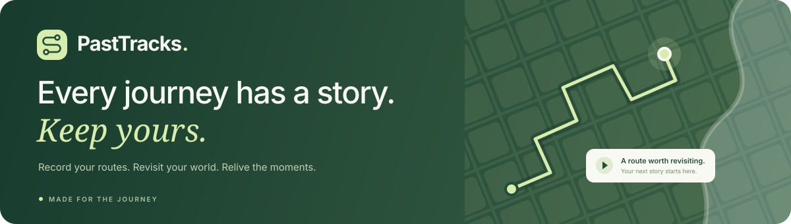
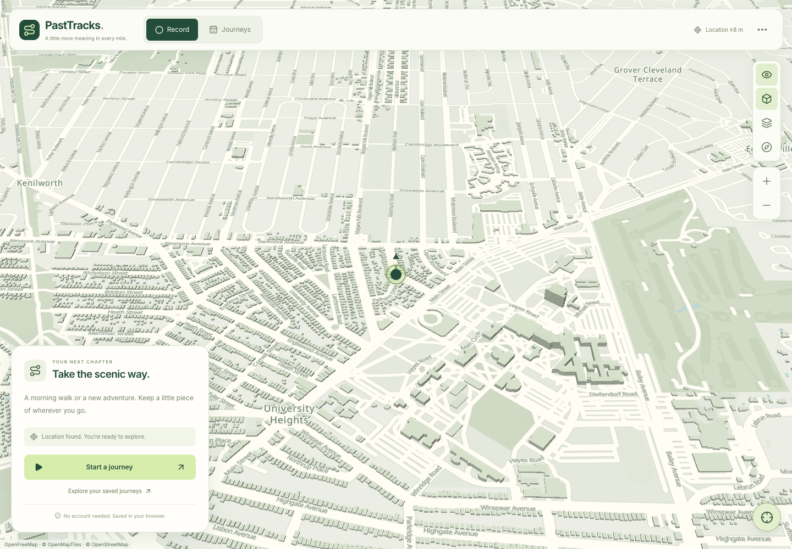
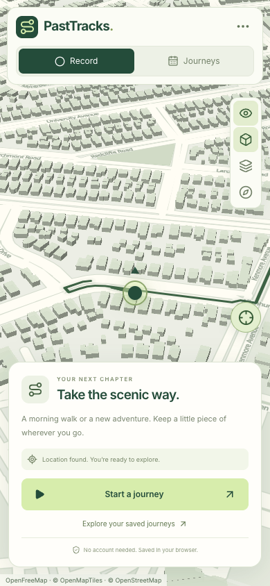

<p align="center">
  
</p>

<p align="center">
  A welcoming GPS travel journal for the morning walk, the long way home, and everywhere in between.
</p>

<p align="center">
  
  
  
  
  
  
</p>

<p align="center">
  <a href="https://past-tracks.vercel.app/"><strong>🌿 Open PastTracks</strong></a>
  &nbsp; · &nbsp;
  <a href="https://github.com/rajashekarakula19-spec/past-tracks">View repository</a>
</p>

---

## 🗺️ A little look around

### A welcoming first step


The [main link](https://past-tracks.vercel.app/) opens the landing page first. Choose **Start your journey** or **Open app** when you’re ready to explore. The landing map is an illustration with sample journey statistics.

### Your world, in Garden colors



**PastTracks Garden** brings ivory roads, sage parks, muted blue water, and forest-green routes to the interactive map. Matching journey cards keep distance, time, and replay a glance away.

<details>
<summary><strong>📱 See the mobile view</strong></summary>
<br />
<p align="center">
  
</p>
</details>

## ✨ Made for the journey

| | What you can do |
| --- | --- |
| 📍 **Record** | Start, pause, resume, and save GPS journeys with distance, speed, duration, and location accuracy. |
| 🗓️ **Rediscover** | Browse trips by date, inspect saved routes, and manage your travel history. |
| ▶️ **Relive** | Replay journeys with adjustable speed and an interactive timeline. |
| 🎨 **Make it yours** | Switch between Garden, street, satellite, night, and city maps; toggle routes and 3D perspective. |
| 💾 **Keep a copy** | Store trips in your browser and export all journeys as JSON or a single route as GeoJSON. |
| 🧭 **Try it out** | Explore sample trips and simulated journeys before heading outside. |

## 🚀 Get started

Install **Node.js 22+** and npm, then run:

```bash
git clone https://github.com/rajashekarakula19-spec/past-tracks.git
cd past-tracks
npm ci
npm run dev
```

Open [localhost:5173](http://localhost:5173). No environment variables, API keys, or separate backend are required for the current configuration.

| Command | Purpose |
| --- | --- |
| `npm run dev` | Start the development server on port 5173. |
| `npm run build` | Run TypeScript checks and build the production app in `dist/`. |
| `npm run preview` | Preview the production build locally. |

## 🌱 Your first journey

1. Open the welcome page and choose **Start your journey**.
2. Allow location access, then select **Start a journey** in the recorder.
3. Watch your distance, time, and speed; pause or resume whenever you need.
4. Choose **Finish & save**, then find the trip under **Journeys**.
5. Open a route, tap its replay button, or use **Export all** to keep a backup.

**Finding your way around:** **Record** is your recorder, **Journeys** is your history, and the layers icon opens **Map styles**. The **More options** menu contains demo journeys, developer tools, and a link back to the welcome page. Clicking the PastTracks logo also takes you home.

The tracker loads when first opened at `/#app`. Returning to the landing page through in-page navigation preserves the app’s recording and selected journey. Sample trips are added when the trip store is empty.

## 🛠️ Under the hood

| Layer | Tools |
| --- | --- |
| Interface | React 19 · TypeScript · Tailwind CSS |
| Build | Vite 6 |
| Maps & geography | MapLibre GL JS · Turf.js · OpenFreeMap |
| Motion | Framer Motion · Canvas Confetti |
| Storage | IndexedDB through `idb-keyval` |

```text
src/
├── components/
│   ├── HUD/              # Recorder, history, journey cards, and demo tools
│   ├── Map/              # Interactive map and style controls
│   ├── Timeline/         # Journey replay controls
│   └── UI/               # Shared UI components
├── services/             # GPS, storage, simulation, and road snapping
├── types/                # Trip and tracking types
├── utils/                # Geographic helpers and Garden map style
├── LandingPage.tsx       # Welcome page and illustrated journey map
├── landing.css           # Landing page styles
├── app-ui.css            # App navigation, recorder, and replay styles
├── App.tsx               # Tracker state and layout
└── main.tsx              # Landing/app navigation and lazy loading
```

## 🔒 Your journeys & your browser

Trips stay in the current browser’s **IndexedDB**. They do not automatically sync across browsers or devices, and clearing site data removes them. Export journeys you want to keep.

Live tracking needs location permission and a secure context: **HTTPS** when deployed, or **localhost** during development. Keep the app open while recording; background tabs and locked screens may interrupt location updates. Screen wake lock is used where supported.

Maps and road routing require internet access. The current implementation loads map resources from Google, CARTO, and OpenFreeMap, and sends route coordinates to the public OSRM service for road snapping. Garden tiles and labels use OpenFreeMap, OpenMapTiles, and OpenStreetMap data.

## ☁️ Deployment

PastTracks is hosted on [Vercel](https://past-tracks.vercel.app/). For a static deployment, install with `npm ci`, build with `npm run build`, and publish **`dist/`**. Serve over HTTPS to enable GPS tracking.

---

<p align="center">
  <strong>🌿 Made for the journey, and the memories.</strong><br />
  <a href="https://past-tracks.vercel.app/">Your next story starts here ↗</a>
</p>
