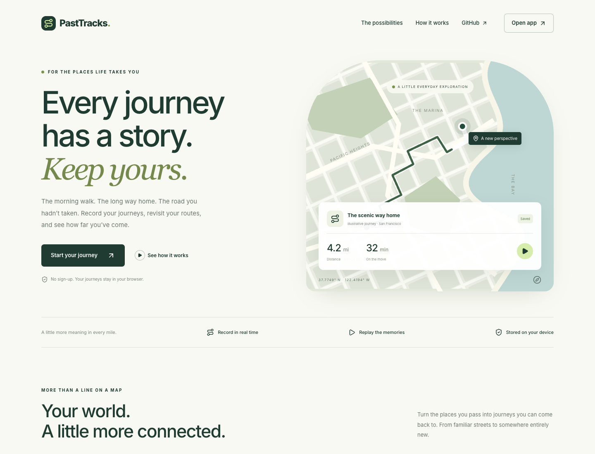

# PastTracks

Record your journeys, explore your travel history, and replay past routes on an interactive map. PastTracks is a responsive GPS tracking web app built with React and TypeScript.

**[Open the live app](https://past-tracks.vercel.app)** · [GitHub repository](https://github.com/rajashekarakula19-spec/past-tracks)

## Landing page



Visitors arrive at a responsive welcome page with an illustrated example route, an overview of recording and replay, and a three-step introduction. **Open app** and the journey buttons open the existing tracker at `/#app`. Location permission is requested by the tracker, not the landing page. The map on the landing page is a decorative illustration; its journey statistics are sample content.

The landing page uses warm ivory, forest green, and lime accents, with keyboard-accessible navigation, a mobile menu, and reduced-motion support. The tracker is lazy-loaded when opened. Use browser Back to return to the landing page.

### PastTracks Garden map style

The history sidebar and selected-trip details use matching ivory journey cards with distance, time, and lime replay controls. Date filters, multi-select deletion, and exports remain available.

The tracker opens with **PastTracks Garden**, a custom vector map inspired by the welcome page: ivory roads, sage parks and buildings, muted blue water, and forest-green routes. Open **Change map style** (the layers icon) to switch between Garden and the existing street, satellite, dark, and 3D vector styles. Real map tiles and labels are provided by OpenFreeMap / OpenMapTiles / OpenStreetMap and require internet access.

## Features

- **Live GPS tracking:** Start, pause, resume, and save journeys with distance, speed, duration, and location accuracy indicators.
- **Travel history:** Browse saved trips by date, inspect route statistics, and delete individual or multiple journeys.
- **Journey replay:** Follow recorded routes with playback controls, adjustable speed, and a timeline scrubber.
- **Interactive maps:** Switch between road, satellite, and vector map styles, and toggle route visibility.
- **Local trip storage:** Save journeys in the browser using IndexedDB and download a JSON backup with **Export All**.
- **Demo and simulation tools:** Explore sample journeys and simulate movement without taking a trip.

## Tech stack

React 19, TypeScript, Vite 6, Tailwind CSS, MapLibre GL JS, Turf.js, Framer Motion, and IndexedDB through `idb-keyval`.

## Run locally

Install Node.js 22+ and npm, then run:

```bash
git clone https://github.com/rajashekarakula19-spec/past-tracks.git
cd past-tracks
npm ci
npm run dev
```

Open [localhost:5173](http://localhost:5173). No environment variables, API keys, or separate backend are required for the current configuration.

| Command | Purpose |
| --- | --- |
| `npm run dev` | Start the development server on port 5173. |
| `npm run build` | Run TypeScript checks and create the production build in `dist/`. |
| `npm run preview` | Serve the production build locally for review. |

## Using the app

1. Open the welcome page, choose **Start your journey** or **Open app**, and allow browser location access in the tracker.
2. Start live tracking, then pause or resume as needed.
3. Stop and save the journey to view it in your history.
4. Select a date and trip to inspect its route or start a replay.
5. Use **Export All** in the history panel to download your trips as JSON.

Sample trips are added when the trip store is empty, so you can explore history and replay before recording your own journey.

## Storage and browser requirements

Trips are stored in the current browser's IndexedDB. They do not automatically sync across browsers or devices, and clearing site data removes them. Export trips you want to keep.

Live tracking requires location permission and a secure context: use HTTPS for a deployed app or localhost for development. Keep the app open while recording; background tabs and locked screens may interrupt location updates. Screen wake lock is used where supported.

Maps and road routing depend on external services and an internet connection. The current implementation loads map resources from Google, CARTO, and OpenFreeMap, and sends route coordinates to the public OSRM service for road snapping.

## Project structure

```text
src/
├── components/
│   ├── HUD/          # Tracking controls, history, statistics, and simulator
│   ├── Map/          # Map rendering and controls
│   ├── Timeline/     # Journey replay controls
│   └── UI/           # Shared UI components
├── services/         # GPS tracking, storage, simulation, and road snapping
├── types/            # Trip and tracking types
├── utils/            # Geographic helpers and map styles
├── LandingPage.tsx   # Welcome page and illustrated journey map
├── landing.css       # Responsive landing page styles
├── App.tsx           # Tracker state and main layout
└── main.tsx          # Hash navigation and lazy-loaded tracker
```

## Deployment

The live app is hosted on [Vercel](https://past-tracks.vercel.app). To deploy this project as a static site, install dependencies with `npm ci`, build with `npm run build`, and publish the `dist/` directory. Serve it over HTTPS to enable GPS tracking.
